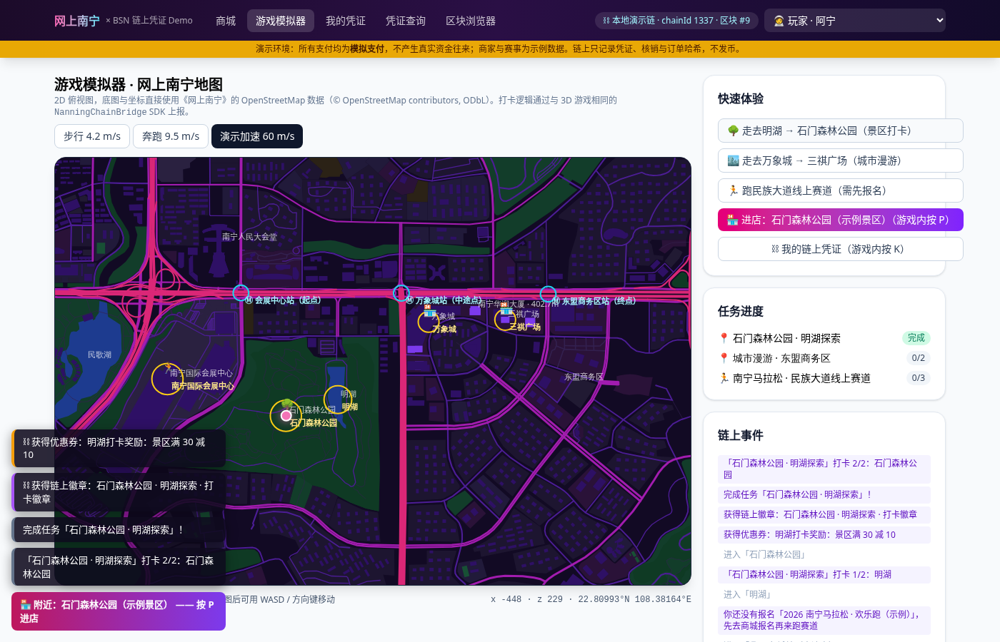
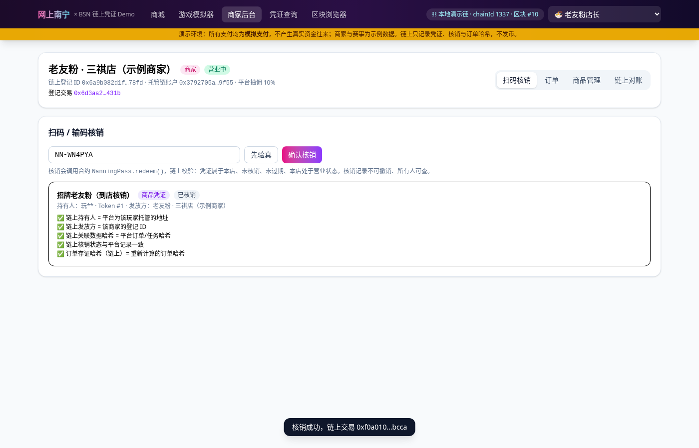
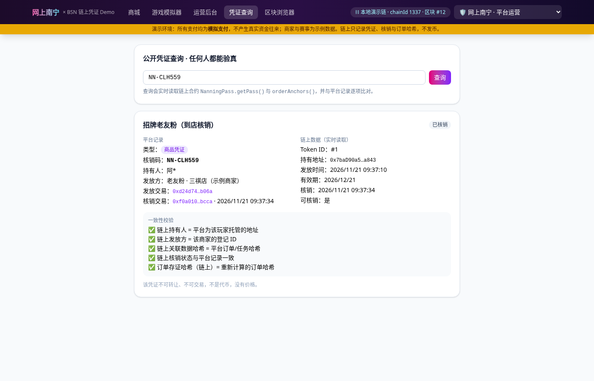

# 网上南宁 × BSN 武汉链 · 链上凭证 Demo

让《网上南宁》里的门票、商品、赛事和打卡变成**现实中的商家敢认的凭证**：
商家、景区、赛事主办方入驻后，玩家在游戏里购买、打卡、跑赛道，
平台把**不可转让的凭证、核销记录和订单哈希**写到 **BSN 武汉链**，多方按同一份账本对账。

> **在线 Demo**：https://nanning-chain-demo-staging.up.railway.app （Railway staging，`agent/bsn-demo-v1` 分支自动部署；local 演示链模式，服务重启后数据会重置）
>
> 演示环境：支付全部是**模拟支付**；商家、景区、赛事都是示例数据。链上**不发币**，也不记录任何个人信息。


---

## 1. 能体验什么

| 场景 | 流程 | 链上发生了什么 |
|---|---|---|
| 商家入驻 | 提交申请 → 平台审核通过 | `NanningRegistry.registerMerchant`：登记商家 ID 和资料哈希 |
| 游戏内 / 商城购买 | 下单（可用平台券）→ 模拟支付 | `NanningPass.anchorOrder`：订单哈希存证；`mintPass`：每份商品发一张凭证 |
| 到店核销 / 快递发货 | 商家输入核销码，或者填快递单号 | `NanningPass.redeem`：链上核销，不能撤销 |
| 景区打卡 | 游戏里走到明湖和石门森林公园 | 发放打卡徽章 + 景区门票优惠券 |
| 马拉松（线上 + 线下） | 报名 → 游戏里按顺序跑完民族大道 → 现场签到 | 发放参赛凭证，现场签到时核销；两步都完成后发放**完赛证书** |
| 公开验真 / 对账 | 任何人输入核销码；商家逐笔对账 | 实时读取 `getPass` / `orderAnchors`，和平台记录逐项比对 |

| 游戏模拟器（真实南宁地图） | 3D 游戏实测（接入补丁） |
|---|---|
|  |  |
| **商家核销** | **公开验真** |
|  |  |

## 2. 合规设计：用「三层价值」代替「1:1 人民币代币」

| 层 | 用途 | 红线 |
|---|---|---|
| 🪙 金币（游戏币） | 只能买游戏内的虚拟道具 | 不能兑换实物、门票、商家商品，不能提现（文市发〔2009〕20 号第八条） |
| ¥ 人民币直付 | 门票、周边、到店商品、赛事报名 | 不建资金池、不发 1:1 代币。正式环境走微信支付「平台收付通」：钱直接进商家二级商户号，平台通过分账抽佣，通过补差接口承担优惠券 |
| 🎟️ 平台优惠券 | 打卡、完赛获得，下单时抵扣 | 平台出资；不能购买、不能转让、不能提现 |
| ⛓ 链上凭证 | 门票、商品凭证、参赛凭证、完赛证书、打卡徽章 | ERC-1155 **不可转让**（`transfer` 和 `setApprovalForAll` 一律 revert），没有价格，不是代币 |

## 3. 架构

```
apps/web            React + Vite + Tailwind：玩家端 / 商家后台 / 运营后台 / 游戏模拟器 / 凭证查询 / 区块浏览器
apps/server         Fastify + ethers v6：业务 API、上链队列（平台签名、平台付能量值）、对账、游戏事件
packages/contracts  Solidity 0.8.19（evmVersion london）+ Hardhat：NanningRegistry、NanningPass
packages/game-sdk   NanningChainBridge：零依赖单文件，游戏接入只需 init()、tick(x, z)
integration/        给《网上南宁》Three.js 游戏的接入补丁（已实测能构建、能运行）
```

- **local 模式（默认）**：server 在进程内启动一条 London 硬分叉的 EVM 链。武汉链也是以太坊内核（geth 1.10.17），所以同一份字节码可以直接部署上去。不需要任何账号就能完整体验。
- **bsn 模式**：连接 BSN 武汉链网关，合约和代码都不用改，只改环境变量。

### 和 BSN 武汉链对齐的细节

参考 [BSN-DDC/wuhanchain](https://github.com/BSN-DDC/wuhanchain)（官方 DDC 合约 + Java SDK）和 BSN 文档《7.3.3 武汉链网关接入说明》：

| 项 | 武汉链 | 本项目 |
|---|---|---|
| 内核 | Ethereum v1.10.17（London） | `evmVersion: london`，已检查字节码中没有 PUSH0 |
| 编译器 | 官方 DDC 合约用 solc 0.8.7 / london | solc 0.8.19 / london |
| Chain ID | 5555 | `CHAIN_ID=5555` |
| 交易 | 官方 SDK 用 legacy 交易 + `eth_gasPrice`（默认 1 gwei） | `type: 0`，`GAS_PRICE_WEI=1000000000` |
| 接入 | RPC = `网关地址/api/<项目ID>/rpc`；项目 key 放在请求头 `x-api-key` | `CHAIN_RPC_URL`、`BSN_PROJECT_KEY` |
| 密钥模式 | 新建链账户不再支持密钥托管，用「发布公钥 / 上传链账户地址」自己签名 | 平台私钥只放在 `PLATFORM_PRIVATE_KEY`（部署平台的 Secret） |
| 浏览器 | wuhanexplorer.bsnbase.com | `EXPLORER_TX_URL` |

## 4. 本地运行

需要 Node 20 或 22。

```bash
npm install
npm run build              # 构建 game-sdk 和前端
npm start                  # http://localhost:8787 （API + 前端 + 演示链）
```

开发模式：`npm run dev:server` 和 `npm run dev:web`（http://localhost:5173，`/api` 会代理到 8787）。

右上角可以切换演示身份：玩家「阿宁 / 小邕」；商家「老友粉 / 壮锦文创 / 石门森林公园 / 马拉松组委会 / 邕州茶语（待审核）」；平台运营。

### 测试

```bash
npm run test -w packages/contracts   # 6 个合约测试：权限、存证只写一次、核销一次、不可转让、徽章不可核销、过期
npm run test -w apps/server          # 7 个端到端测试：下单→支付→上链→验真→核销、快递、景区打卡、马拉松双线、对账、审核
npm run typecheck
```

## 5. 切换到 BSN 武汉链

1. 在 [opb.bsnbase.com](https://opb.bsnbase.com)（开放联盟链门户，大众版）注册。正式上线时改为 [BSN-DDC 平台方](https://ddc.bsnbase.com)（企业版，TPS 100）。两者是**同一条链**，合约不用迁移。
2. 创建项目，选择「武汉链」，下载接入参数：网关地址、项目 ID，以及项目 key（如果开启了）。
3. 本地生成平台私钥，用「上传链账户地址」模式创建链账户，然后**充能量值**（人民币）。
4. 部署合约（只需一次）：
   ```bash
   cd packages/contracts
   BSN_RPC_URL=https://<网关>/api/<项目ID>/rpc BSN_CHAIN_ID=5555 PLATFORM_PRIVATE_KEY=0x... npm run deploy:bsn
   ```
5. 启动 server：
   ```bash
   CHAIN_MODE=bsn CHAIN_RPC_URL=... CHAIN_ID=5555 PLATFORM_PRIVATE_KEY=0x... \
   REGISTRY_ADDRESS=0x... PASS_ADDRESS=0x... DATA_DIR=/data npm start
   ```
   bsn 模式下业务数据写到 `DATA_DIR/db.json`，生产环境建议换成 PostgreSQL。完整变量见 `apps/server/.env.example`。

## 6. API（节选）

| 方法 | 路径 | 说明 |
|---|---|---|
| GET | `/api/chain/info` / `/api/chain/tx/:hash` | 链信息；交易详情（解码出合约调用和事件） |
| GET | `/api/passes/verify/:code` | 公开验真：链上数据和平台记录逐项比对 |
| POST | `/api/orders`、`/api/orders/:id/pay` | 下单、模拟支付，然后订单存证并发放凭证 |
| POST | `/api/merchant/redeem`、`/api/merchant/orders/:id/ship` | 核销、发货（发货时在链上记录履约） |
| GET | `/api/merchant/reconcile` | 链上对账 |
| POST | `/api/admin/merchants/:id/approve` | 审核通过后在链上登记商家 |
| GET / POST | `/api/game/config`、`/api/game/events` | 游戏对接：打卡点、任务、商家位置；上报进入打卡点（可选 HMAC 签名） |

演示环境的身份通过请求头 `x-demo-user` 传递。正式环境要换成真实的登录鉴权。

## 7. 接入《网上南宁》游戏

见 [`integration/nanning_project/README.md`](integration/nanning_project/README.md)。补丁基于公开仓库 `JayZz210l/nanning_project`。已实测：tsc 和 vite build 通过，原有测试 10/10 通过；在无头浏览器里能完成打卡、链上发放徽章、按 P 进店。

## 8. 上线前清单

- [ ] 支付换成微信支付平台收付通：服务商入驻、商家作为二级商户进件、分账、补差
- [ ] 真实账号体系 + 实名认证；游戏事件改由游戏服务器 HMAC 签名上报
- [ ] 托管私钥改用 KMS/HSM；业务数据改用 PostgreSQL
- [ ] 网信办区块链信息服务备案、ICP；门票和赛事拿到主办方书面授权
- [ ] 正式切换到 BSN-DDC 平台方（企业版）

---

地图数据：`apps/web/public/data/nanning.json` 取自《网上南宁》仓库，来源 © OpenStreetMap contributors，遵循 ODbL 协议。
